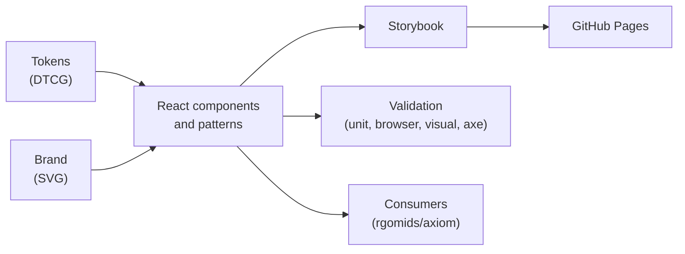

<p align="right">
  <strong>English</strong> | <a href="docs/README.pt-BR.md">Português (Brasil)</a>
</p>

<p align="center">
  <picture>
    <source media="(prefers-color-scheme: dark)" srcset="packages/brand/svg/axiom-logo-dark.svg">
    
  </picture>
</p>

<h1 align="center">Axiom Design System</h1>

<p align="center"><strong>Tokens, components, and brand for every Axiom surface.</strong></p>

<p align="center">
  <a href="LICENSE"></a>
  <a href="package.json"></a>
  <a href="https://github.com/rgomids/axiom-ds/commits/main/"></a>
  <a href="https://github.com/rgomids/axiom-ds/stargazers"></a>
</p>

Axiom Design System is the dedicated design system of the
[Axiom](https://github.com/rgomids/axiom) project: design tokens, a React
component library, diagram components, and the approved brand assets.
[rgomids/axiom](https://github.com/rgomids/axiom) remains responsible for the
product and its integration.

Git is the technical source of truth; Penpot explores visual decisions;
Storybook documents executable code.

## Why a dedicated design system?

- **One visual language.** Semantic tokens keep every Axiom surface consistent
  across light and dark themes.
- **Accessible by default.** Radix Primitives own complex behavior; keyboard,
  focus, and axe checks run in the browser.
- **Reviewable changes.** Visual baselines make every rendering change explicit
  before it lands.
- **Owned code, no lock-in.** shadcn/ui-style components live in the
  repository, under Apache-2.0, with zero mandatory recurring cost.

## Getting Started

### 1. Install

Requires Node.js 22.16+ and npm. The same commands serve local and Cloud
agents:

```sh
npm ci
npx playwright install chromium
```

### 2. Explore in Storybook

```sh
npm run storybook
```

Storybook runs at http://localhost:6006. If that port is taken, run the CLI
with another port. To preview the static build, use `npm run serve:storybook`
(http://127.0.0.1:6108). The published Storybook is at
[rafaelgomides.dev.br/axiom-ds](http://rafaelgomides.dev.br/axiom-ds/).

### 3. Consume

The React library uses shadcn/ui code maintained in the repository, Radix
Primitives, and Tailwind CSS. In a consumer with a bundler:

```tsx
import { Button } from '@axion/ui';
import '@axion/ui/theme.css';

export function Save() {
  return <Button type="button">Save project</Button>;
}
```

Set `data-theme="light"` or `data-theme="dark"` on `<html>` so portals are
themed too. React 19 is a peer dependency. The version is 0.3.0 and not yet
stable. `npm run build` generates JavaScript, TypeScript declarations, CSS, and
tokens; `npm pack --workspace @axion/ui` prepares a local package. npm
publication is not required.

## How it works



Primitive tokens feed semantic and component tokens, which in turn style the
components. Tokens come before new visual literals, and semantic roles before
raw palette names.

## Core concepts

| Concept                                           | Meaning                                                                                                                                                                                      |
| ------------------------------------------------- | -------------------------------------------------------------------------------------------------------------------------------------------------------------------------------------------- |
| [Tokens](packages/tokens/src)                     | DTCG primitives, semantic roles, component tokens, and the dark theme.                                                                                                                       |
| [Themes](docs/themes.md)                          | The light/dark contract and Geist v0.2 roles.                                                                                                                                                |
| [Components](packages/ui/src/react)               | React library: Actions, Forms, Data Display, Navigation, Overlays, Feedback.                                                                                                                 |
| [Diagram Kit](packages/ui/src/diagrams/README.md) | Flow-editor components; see the [catalog](examples/diagram-kit.html) and the [working example](examples/diagram-editor.html) (also with `?theme=dark`), or `Patterns/Diagrams` in Storybook. |
| [Brand](packages/brand/svg)                       | Approved SVG marks, preserved without redrawing.                                                                                                                                             |
| [ADR](docs/adr)                                   | Durable decisions with rationale and trade-offs.                                                                                                                                             |

Controls and icon containers use the `component.icon.radius` token to keep
their square shape without changing the brand or icon drawings. The AXIOM
spelling in the SVGs is preserved; the `@axion` namespace remains for
compatibility.

## Architecture

| Path                         | Responsibility                                              |
| ---------------------------- | ----------------------------------------------------------- |
| `packages/tokens/src`        | DTCG: primitives, semantics, components, and dark theme     |
| `packages/ui/src/react`      | React library                                               |
| `packages/ui/src/lib`        | Typed class composition                                     |
| `packages/ui/src/components` | Previous HTML catalog, kept for compatibility               |
| `packages/brand/svg`         | Approved brand in SVG, unchanged                            |
| `apps/storybook`             | Executable documentation: foundations, variants, and states |
| `tests/components`           | React interactions and contracts                            |
| `tests/visual`               | Browser, accessibility, and regression baselines            |
| `docs/adr`                   | Durable decisions                                           |
| `.github/workflows`          | Validation and Pages publication                            |

The [catalog](index.html) and the [HTML index](resources.html) preserve the
previously approved models. They do not replace Storybook for the acceptance
of issue #2. See the [architecture](docs/architecture.md) and
[foundations](docs/foundations.md).

## Documentation

| Topic        | Start here                                                                                                         |
| ------------ | ------------------------------------------------------------------------------------------------------------------ |
| Using the DS | [Getting Started](#getting-started) · [Integration](docs/integration.md) · [Themes](docs/themes.md)                |
| Design       | [Foundations](docs/foundations.md) · [Accessibility](docs/accessibility.md) · [Penpot](docs/penpot.md)             |
| Architecture | [Architecture](docs/architecture.md) · [ADRs](docs/adr)                                                            |
| Governance   | [Governance](docs/governance.md) · [Delivery sequence](docs/delivery-sequence.md) · [Discovery](docs/discovery.md) |
| Delivery     | [Publication](docs/publication.md) · [Dependencies](docs/dependencies.md) · [Cloud](docs/cloud.md)                 |
| Community    | [Contributing](CONTRIBUTING.md) · [Agent rules](AGENTS.md)                                                         |
| Security     | [Security policy](SECURITY.md)                                                                                     |
| History      | [Changelog](CHANGELOG.md)                                                                                          |

## Developing the Design System

```sh
npm run validate
npm run test:browser
npm run test:visual
```

`validate` covers formatting, lint, TypeScript, build, token tests, component
tests, and the Storybook build. The visual test compares versioned baselines in
light/dark themes on desktop/mobile, and runs axe and keyboard checks. Update
baselines only after reviewing the images: `npm run test:visual:update`.

## Landing page

The Axiom landing page belongs to [rgomids/axiom](https://github.com/rgomids/axiom),
which keeps a pinned copy of the last revision published here (`d5c3dc4`).
This repository publishes only the Design System Storybook; see
[ADR 0005](docs/adr/0005-remove-landing-from-design-system.md).

## Publication

Publication uses GitHub Pages and GitHub Actions, with no mandatory paid SaaS.
Fork PRs do not publish. The Pages workflow runs on the canonical `main` after
maintainer approval. The external Notion criterion is in
[docs/discovery.md](docs/discovery.md) and is not considered met without
verification.

## Contributing

Read [AGENTS.md](AGENTS.md), [CONTRIBUTING.md](CONTRIBUTING.md), and the
[delivery sequence](docs/delivery-sequence.md). Keep changes small, include
reproducible validation, and commit reviewed visual baselines with the change.

## Security

Report suspected vulnerabilities privately through [SECURITY.md](SECURITY.md).

## License

Axiom Design System is licensed under the Apache License 2.0. See
[LICENSE](LICENSE). shadcn/ui code keeps its MIT notice; see
[THIRD_PARTY_NOTICES.md](THIRD_PARTY_NOTICES.md).
