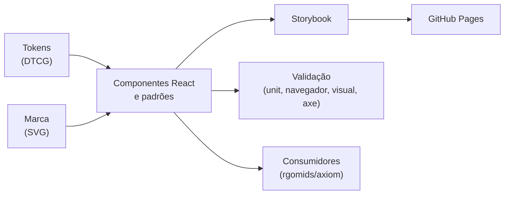

<p align="right">
  <a href="../README.md">English</a> | <strong>Português (Brasil)</strong>
</p>

<p align="center">
  <picture>
    <source media="(prefers-color-scheme: dark)" srcset="../packages/brand/svg/axiom-logo-dark.svg">
    
  </picture>
</p>

<h1 align="center">Axiom Design System</h1>

<p align="center"><strong>Tokens, componentes e marca para todas as superfícies do Axiom.</strong></p>

<p align="center">
  <a href="../LICENSE"></a>
  <a href="../package.json"></a>
  <a href="https://github.com/rgomids/axiom-ds/commits/main/"></a>
  <a href="https://github.com/rgomids/axiom-ds/stargazers"></a>
</p>

O Axiom Design System é o design system dedicado do projeto
[Axiom](https://github.com/rgomids/axiom): design tokens, biblioteca de
componentes React, componentes de diagrama e os ativos de marca aprovados.
[rgomids/axiom](https://github.com/rgomids/axiom) continua responsável pelo
produto e pela sua integração.

Git é a fonte técnica; Penpot explora decisões visuais; Storybook documenta
código executável.

## Por que um design system dedicado?

- **Uma linguagem visual.** Tokens semânticos mantêm todas as superfícies do
  Axiom consistentes nos temas claro e escuro.
- **Acessível por padrão.** Radix Primitives cuida dos comportamentos
  complexos; checks de teclado, foco e axe rodam no navegador.
- **Mudanças revisáveis.** Baselines visuais tornam explícita toda mudança de
  renderização antes do merge.
- **Código próprio, sem lock-in.** Componentes no estilo shadcn/ui vivem no
  repositório, sob Apache-2.0, sem custo recorrente obrigatório.

## Primeiros passos

### 1. Instalar

Requer Node.js 22.16+ e npm. Os mesmos comandos atendem agentes locais e Cloud:

```sh
npm ci
npx playwright install chromium
```

### 2. Explorar no Storybook

```sh
npm run storybook
```

O Storybook roda em http://localhost:6006. Se essa porta estiver ocupada,
execute o CLI com outra porta. Para visualizar o build estático, use
`npm run serve:storybook` (http://127.0.0.1:6108). O Storybook publicado está em
[rafaelgomides.dev.br/axiom-ds](http://rafaelgomides.dev.br/axiom-ds/).

### 3. Consumir

A biblioteca React usa código shadcn/ui mantido no repositório, Radix
Primitives e Tailwind CSS. No consumidor com bundler:

```tsx
import { Button } from '@axion/ui';
import '@axion/ui/theme.css';

export function Save() {
  return <Button type="button">Salvar projeto</Button>;
}
```

Defina `data-theme="light"` ou `data-theme="dark"` no `<html>` para incluir os
portais. React 19 é peer dependency. A versão é 0.3.0, ainda não estável.
`npm run build` gera JavaScript, declarações TypeScript, CSS e tokens;
`npm pack --workspace @axion/ui` prepara um pacote local. Publicação no npm não
é necessária.

## Como funciona



Tokens primitivos alimentam tokens semânticos e de componente, que estilizam os
componentes. Tokens vêm antes de novos literais visuais, e papéis semânticos
antes de nomes crus da paleta.

## Conceitos principais

| Conceito                                             | Significado                                                                                                                                                                                                |
| ---------------------------------------------------- | ---------------------------------------------------------------------------------------------------------------------------------------------------------------------------------------------------------- |
| [Tokens](../packages/tokens/src)                     | DTCG: primitivos, papéis semânticos, tokens de componente e tema escuro.                                                                                                                                   |
| [Temas](themes.md)                                   | O contrato claro/escuro e os papéis do Geist v0.2.                                                                                                                                                         |
| [Componentes](../packages/ui/src/react)              | Biblioteca React: Actions, Forms, Data Display, Navigation, Overlays, Feedback.                                                                                                                            |
| [Diagram Kit](../packages/ui/src/diagrams/README.md) | Componentes do editor de fluxos; veja o [catálogo](../examples/diagram-kit.html) e o [exemplo funcional](../examples/diagram-editor.html) (também com `?theme=dark`), ou `Patterns/Diagrams` no Storybook. |
| [Marca](../packages/brand/svg)                       | Marcas aprovadas em SVG, preservadas sem alteração de desenho.                                                                                                                                             |
| [ADR](adr)                                           | Decisões duráveis com justificativa e trade-offs.                                                                                                                                                          |

Os controles e os contêineres de ícones usam o token `component.icon.radius`
para manter o formato quadrado sem alterar os desenhos da marca ou dos ícones.
A grafia AXIOM dos SVGs foi preservada; o namespace `@axion` permanece por
compatibilidade.

## Arquitetura

| Caminho                      | Responsabilidade                                          |
| ---------------------------- | --------------------------------------------------------- |
| `packages/tokens/src`        | DTCG: primitivos, semânticos, componentes e tema escuro   |
| `packages/ui/src/react`      | Biblioteca React                                          |
| `packages/ui/src/lib`        | Composição de classes tipada                              |
| `packages/ui/src/components` | Catálogo HTML anterior, mantido por compatibilidade       |
| `packages/brand/svg`         | Marca aprovada em SVG, sem alteração                      |
| `apps/storybook`             | Documentação executável: fundamentos, variantes e estados |
| `tests/components`           | Interações e contratos React                              |
| `tests/visual`               | Navegador, acessibilidade e baselines de regressão        |
| `docs/adr`                   | Decisões duráveis                                         |
| `.github/workflows`          | Validação e publicação no Pages                           |

O [catálogo](../index.html) e o [índice HTML](../resources.html) preservam os
modelos aprovados anteriores. Não substituem o Storybook na aceitação da
issue #2. Veja a [arquitetura](architecture.md) e os
[fundamentos](foundations.md).

## Documentação

| Tema        | Comece por                                                                                         |
| ----------- | -------------------------------------------------------------------------------------------------- |
| Usar o DS   | [Primeiros passos](#primeiros-passos) · [Integração](integration.md) · [Temas](themes.md)          |
| Design      | [Fundamentos](foundations.md) · [Acessibilidade](accessibility.md) · [Penpot](penpot.md)           |
| Arquitetura | [Arquitetura](architecture.md) · [ADRs](adr)                                                       |
| Governança  | [Governança](governance.md) · [Ordem de entrega](delivery-sequence.md) · [Discovery](discovery.md) |
| Entrega     | [Publicação](publication.md) · [Dependências](dependencies.md) · [Cloud](cloud.md)                 |
| Comunidade  | [Contribuição](../CONTRIBUTING.md) · [Regras de agentes](../AGENTS.md)                             |
| Segurança   | [Política de segurança](../SECURITY.md)                                                            |
| Histórico   | [Changelog](../CHANGELOG.md)                                                                       |

## Desenvolvendo o Design System

```sh
npm run validate
npm run test:browser
npm run test:visual
```

`validate` inclui formatação, lint, TypeScript, build, testes de tokens, testes
de componentes e build do Storybook. O teste visual compara baselines
versionadas nos temas claro/escuro, em desktop/mobile, e executa axe e checks
de teclado. Atualize baselines apenas após revisar as imagens:
`npm run test:visual:update`.

## Landing page

A landing do Axiom pertence a [rgomids/axiom](https://github.com/rgomids/axiom),
que mantém uma cópia fixada da última revisão publicada aqui (`d5c3dc4`).
Este repositório publica apenas o Storybook do Design System; veja o
[ADR 0005](adr/0005-remove-landing-from-design-system.md).

## Publicação

A publicação usa GitHub Pages e GitHub Actions, sem SaaS pago obrigatório.
PRs de forks não publicam. O workflow do Pages é executado na `main` canônica
após aprovação do mantenedor. O critério externo do Notion está em
[discovery.md](discovery.md) e não é considerado atendido sem verificação.

## Contribuindo

Leia [AGENTS.md](../AGENTS.md), [CONTRIBUTING.md](../CONTRIBUTING.md) e a
[ordem de entrega](delivery-sequence.md). Mantenha mudanças pequenas, inclua
validação reproduzível e faça commit das baselines visuais revisadas junto com
a mudança.

## Segurança

Reporte vulnerabilidades suspeitas de forma privada pelo
[SECURITY.md](../SECURITY.md).

## Licença

O Axiom Design System é licenciado sob a Apache License 2.0. Veja
[LICENSE](../LICENSE). O código shadcn/ui conserva o aviso MIT; veja
[THIRD_PARTY_NOTICES.md](../THIRD_PARTY_NOTICES.md).
